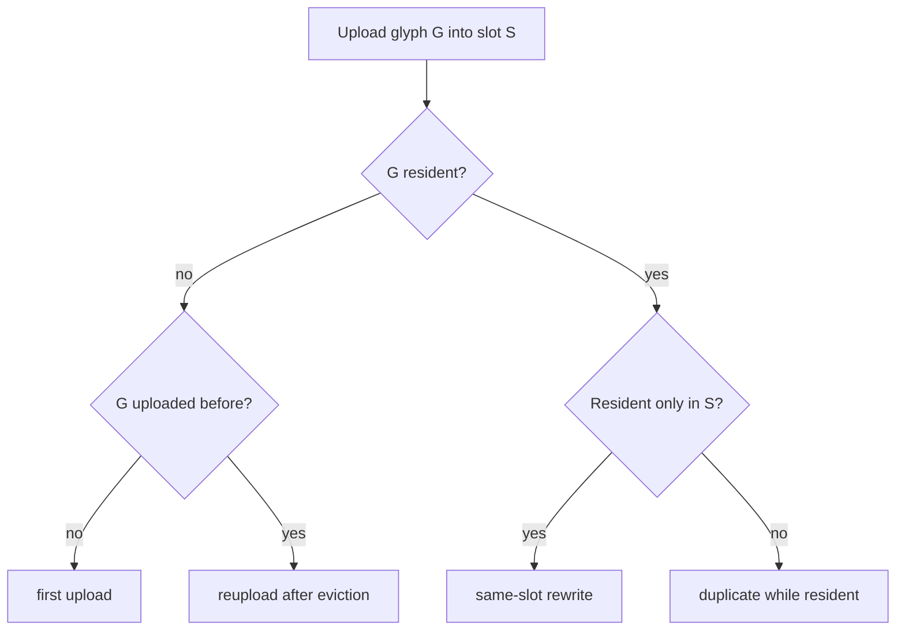

# Charset Upload Redundancy Report — Design

## 1. Goal

Quantify how much of the encoded character-set traffic is **churn**: a glyph is uploaded, later overwritten in its slot by a different glyph, and then uploaded again when it is needed again.

The checker is implemented in `src/c64-encoder-reporting/src/checks/char_redundancy.rs`, with its summary type in `src/c64-encoder-reporting/src/reports/command_report.rs`. Its results are printed as Markdown tables at the end of the `encode_cube` report.

## 2. What is measured

The C64 decoder starts with an all-zero charset. Every `UpdateCharsU16Encoded` / `UpdateCharsRangedU16Encoded` command writes encoded 16-bit glyph values into charset slots. The checker walks the **final chosen stream** (not the candidate streams) in command order and compares each upload with the charset state it sees.

Comparison is done on the encoded `u16` value produced by `charmap::encoding::encode_char()`, because that is what is actually stored in charset memory.

### 2.1 Classification

For a glyph `G` uploaded into slot `S`:

| Category | Condition |
|---|---|
| **first upload** | `G` is not currently resident in any slot and was never uploaded before |
| **reupload after eviction** | `G` is not currently resident, but was uploaded earlier |
| **duplicate while resident** | `G` is already resident in another slot (or in multiple slots including `S`) |
| **same-slot rewrite** | `G` is resident only in `S`, so the write is a no-op |

The first three categories except `first upload` are counted as redundant. The report shows them separately so the cause of the churn is visible.

### 2.2 State maintained

- `charset: [u16; 256]` — current encoded glyph per slot, initialized to `0`.
- `resident: HashMap<u16, HashSet<usize>>` — slots currently holding each glyph. Initially glyph `0` is resident in all 256 slots.
- `uploaded_glyphs: HashSet<u16>` — every glyph value seen in an upload so far.

After each upload:

1. classify it,
2. remove `S` from the previous glyph's resident set (deleting the map key if it becomes empty),
3. set `charset[S] = G`,
4. add `S` to `G`'s resident set,
5. mark `G` as seen.

### 2.3 Byte accounting

| Command | Payload per entry | Command header |
|---|---:|---:|
| `UpdateCharsU16Encoded` | 3 B (slot + 16-bit glyph) | 1 B |
| `UpdateCharsRangedU16Encoded` | 2 B (16-bit glyph) | 2 B |

The report separates **upload payload bytes** from **command overhead bytes**. Redundancy percentages are relative to upload payload bytes only.

## 3. Important caveat: capacity, not just allocator quality

Act 1 uploads **846 distinct encoded glyph values** but the VIC-II charset has only **256 slots**. It is therefore impossible to keep every glyph resident. Some reuploads are unavoidable.

The 361 Act-1 reuploads involve **242 distinct glyphs**, with gaps between repeated uploads ranging from **4 to 74 frames**. A better allocator might keep some of these glyphs in spare slots, but the measured 1,085 redundant bytes is an **upper bound on potential savings**, not a guaranteed saving.

The checker deliberately does not model:

- which slots are visible in the previous frame (referencing an already-correct slot is safe, so any resident copy is potentially reusable),
- per-frame slot-allocation conflicts beyond the resident sets,
- whether a different glyph-to-slot assignment would have been globally cheaper.

It is a diagnostic metric, not an optimizer.

## 4. Measured results

Current output of `encode_cube`:

| act | uploads | unique glyphs | first uploads | reuploads after eviction | duplicates while resident | same-slot rewrites | redundant uploads | upload payload B | command overhead B | redundant B | redundant % |
|---:|---:|---:|---:|---:|---:|---:|---:|---:|---:|---:|---:|
| 1 | 1,207 | 846 | 845 | 361 | 1 | 0 | 362 | 3,437 | 51 | 1,085 | 31.57% |
| 2 | 39 | 39 | 38 | 0 | 1 | 0 | 1 | 78 | 2 | 2 | 2.56% |
| **total** | 1,246 | - | 883 | 361 | 2 | 0 | 363 | 3,515 | 53 | 1,087 | 30.92% |

The single duplicate in each act is the all-zero glyph: the decoder starts with zero in every slot, so the first explicit upload of zero is already resident elsewhere.

## 5. Report placement

`print_command_summary()` prints:

1. per-act stream totals,
2. emitted command counts/bytes by opcode,
3. screen-update choice counts,
4. this redundancy table.

All four sections use Markdown tables. This keeps the output copyable into design documents and makes the new metric visible next to the command statistics it explains.

## 6. Possible follow-ups

1. Make the allocator prefer evicting glyphs whose next use is farthest in the future (Belady-style), using the known frame sequence.
2. Reserve a small pool of slots for glyphs with short repeat gaps (4–20 frames).
3. Report the same metric per strategy, so `initial`, `one_charmap`, and `static_with_dynamic_charset` can be compared directly.
4. Only after measuring a concrete reduction, consider adding this as a stream-level statistic rather than an `encode_cube`-only report.
