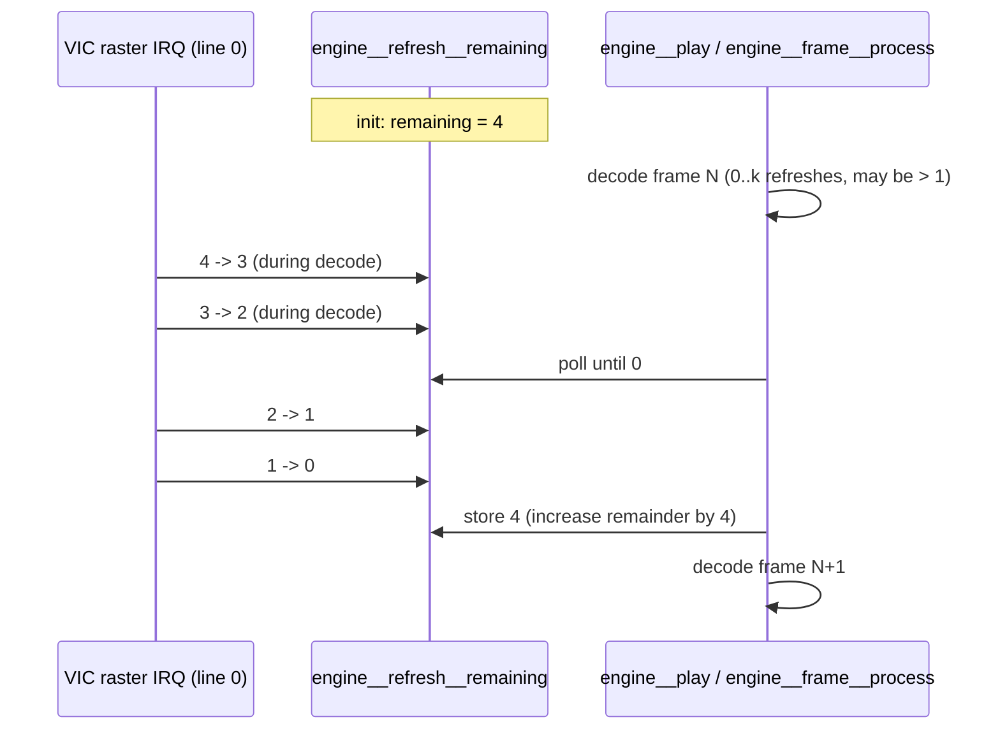

# IRQ-driven refresh countdown for frame pacing — Detailed Design

## 1. Goal and summary

**Problem:** `engine__frame__process` decodes a frame and then calls `engine__vblank__wait` three times. Each call waits for the *next* vblank boundary, so the time spent decoding is added on top of the three refreshes. A frame whose decode crosses a vblank gets an extra refresh; the effective cadence is `3 + ceil(decode_time / refresh_time)` refreshes and jitters from frame to frame.

**Goal:** make the cadence independent of decode duration while playing at the authored 50/4 (12.5 fps) rate. Count refreshes as they happen in an IRQ, and wait only for the refreshes that are still owed. When the count reaches zero, reload it by `REFRESHES_PER_FRAME` (4) and immediately start the next frame.

**Proposed mechanism:** one byte, `engine__refresh__remaining`, is a saturating countdown:

- `engine__init` sets it to 4.
- A raster IRQ at line 0 subtracts 1 from it, but never below 0.
- After decoding a frame, `engine__refresh__wait` polls that byte until it is 0, then stores 4 again ("increase the remainder by 4").

Because the IRQ keeps counting *while the frame is being decoded*, decode time is automatically subtracted from the wait. A frame that takes longer than one (or even four) refresh(es) no longer adds refreshes on top.

**Non-goals:** no double buffering, no shadow VIC register flush, no changes to the encoded stream/encoder/Rust evaluator, and no change in which screen/charset memory the decoders write.

---

## 2. Assumptions and terminology

1. **"Refresh" means one VIC-II frame boundary**, not one horizontal raster line. This follows the current code, which waits for vertical blanking (`BIT $D011`, bit 7). At 50 Hz PAL, one refresh is 20 ms; at 60 Hz NTSC it is ~16.7 ms.
2. The authored framerate is **50/4 = 12.5 fps**, i.e. **4 refreshes per encoded frame** on PAL. This is a deliberate change from the current three refreshes, separate from the drift fix; see §7.4 for the timing impact.
3. The engine is the owner of the raster IRQ. The IRQ demos in the repository (`rasterbar.asm`, `sprite-duplication.asm`, `scrolling.asm`) already establish the project's KERNAL-vector/IRQ-ack style; the engine should follow it.
4. The canonical implementation lives in the Rust generator, `src/c64-encoder/src/command/modules/engine.rs`, not in the stale checked-in `src/engine_gen.asm` (see §6).

---

## 3. Baseline: what happens today

### 3.1 Current code

`src/c64-encoder/src/command/modules/engine.rs:103-127`:

```rust
engine__frame_commands__next:
    jsr engine__commands_left__is_zero
    bne engine__frame_command__process
engine__frame__exit:
    "All commands in frame have been processed."
    "Wait for three vertical refreshes so each frame is displayed for three frames."
    jsr engine__vblank__wait
    jsr engine__vblank__wait
    jsr engine__vblank__wait
    rts
```

`engine__vblank__wait` (same file, lines 128-158) polls `BIT $D011`; bit 7 is the high bit of the raster counter:

```asm
engine__vblank__wait:
    BIT $D011          ; N = bit 8 of raster line
    BMI engine__vblank__wait__in_vblank   ; already in vblank: consume it first
engine__vblank__wait__for_vblank:
    BIT $D011
    BPL engine__vblank__wait__for_vblank  ; wait for vblank to start
    RTS
engine__vblank__wait__in_vblank:
    BIT $D011
    BMI engine__vblank__wait__in_vblank
    JMP engine__vblank__wait__for_vblank
```

Each call therefore waits for the *next* frame boundary; it does not know when the previous one was.

### 3.2 Why it drifts

Let `D` be the decode duration of a frame. The three `JSR`s consume three vblank boundaries *after decoding ends*. If a decode crosses `k` vblank boundaries, the total interval between consecutive decoded frames is `3 + k` refreshes:

| Decode duration | Vblanks crossed during decode | Refreshes per frame |
|---|---:|---:|
| < 1 refresh | 0 | 3 |
| ~1.2 refreshes | 1 | 4 |
| ~2.5 refreshes | 2 | 5 |
| > 3 refreshes | ≥ 3 | ≥ 6, unbounded |

This is the reported problem: "some frames might take longer than one horizontal refresh." The wait is anchored to the *end* of decode instead of to a fixed frame grid.

### 3.3 Timing context

- Today: 3 refreshes/frame → 100 frames ≈ 6.0 s PAL / 5.0 s NTSC (the number quoted in `.designs/block-compressions.md:294`).
- After this change: 4 refreshes/frame → 100 frames ≈ 8.0 s PAL / 6.7 s NTSC.
- The streaming budget note in `.designs/streaming.md` (~80 B/frame) is unaffected; only wall-clock playback slows.

---

## 4. Target behavior

### 4.1 State

| Name | Size | Location | Meaning |
|---|---:|---|---|
| `engine__refresh__remaining` | 1 byte | engine data module (absolute) | Refreshes still owed to the current frame, `0..=4`. `0` means "the interval completed". |
| `engine__refresh__irq_vector_save` | 2 bytes | engine data module | Original `$0314`/`$0315`, restored by `engine__deinit`. |
| `REFRESHES_PER_FRAME` | constant = 4 | Rust | Reload value. |
| `C64_IRQ_VECTOR` | constant `0x0314` | Rust `define_address` | KERNAL IRQ vector low byte. |
| `C64_IRQ_EPLOGUE` | constant `0xEA81` | Rust `define_address` | KERNAL short register-restore/RTI exit. |
| `CIA1_IRQ_CONTROL` / `CIA2_IRQ_CONTROL` | `0xDC0D` / `0xDD0D` | Rust `define_address` | Disabled/acked during setup. |

Using an absolute label (the same pattern as `engine__frames_left` and `engine__commands_left`) avoids competing for scarce zero page: `$10-$11`, `$FB-$FF` and `$A0-$C3` are already claimed by the engine and block decoders. The cost is one extra cycle per IRQ (`DEC abs` = 6 cycles vs `DEC zp` = 5), which is negligible at 50/60 Hz. A zero-page alias is an optional later optimization (§10).

### 4.2 Algorithm

Invariant: `remaining` is only ever written as `4` (by the wait routine) or decremented/saturated by the ISR. It is never wrapped from `0` to `255`.

```
init:      remaining = 4
on refresh (IRQ):  if remaining != 0 then remaining = remaining - 1
after decode:      while remaining != 0 { /* poll */ }
                   remaining = 4          ; "increase the remainder by 4"
```

Let `k` be the number of line-0 IRQs between one reload and the end of the following decode. Then:

```text
waited = max(0, REFRESHES_PER_FRAME - min(k, 4))
total refreshes between frame starts = max(4, k)
```

The wait loop **polls the live byte**; it must not copy it into a local counter. Copying would ignore IRQs arriving after the copy and reintroduce the exact drift we are removing.



### 4.3 Worked examples

| Decode duration | IRQs during decode (`k`) | `remaining` at wait start | IRQs waited | Result |
|---|---:|---:|---:|---|
| 0.1 refresh | 0 | 4 | 4 | 4 refreshes/frame |
| 1.2 refreshes | 1 | 3 | 3 | 4 refreshes/frame |
| 2.9 refreshes | 2 | 2 | 2 | 4 refreshes/frame |
| 3.9 refreshes | 3 | 1 | 1 | 4 refreshes/frame |
| 5 refreshes | 4+ (saturates at 0) | 0 | 0 | 5 refreshes (decode dominates, no extra) |
| 20 refreshes | many (saturates at 0) | 0 | 0 | 20 refreshes; no multi-second stall |

The last two rows are the key improvement: a slow frame costs only its own decode time, not decode time plus four extra refreshes.

---

## 5. 6502 implementation

### 5.1 ISR core (testable) and ISR wrapper

Split the ISR into a callable core and a thin hardware wrapper. The core ends in `RTS` so it can be unit-tested with the `mos6502` crate (which has no IRQ support — see §8.2); the wrapper adds the VIC acknowledge and the KERNAL exit.

```asm
; --- engine__refresh__on_refresh -------------------------------------
; Saturating decrement. Safe to call with IRQs enabled.
engine__refresh__on_refresh:
    LDA engine__refresh__remaining
    BEQ engine__refresh__on_refresh__done   ; 0 is sticky: never wrap to 255
    DEC engine__refresh__remaining
engine__refresh__on_refresh__done:
    RTS

; --- engine__refresh__irq -------------------------------------------
; VIC raster IRQ handler, installed in $0314/$0315.
engine__refresh__irq:
    JSR engine__refresh__on_refresh
    ASL VIC2_IRQ_STATUS        ; RMW ack of VIC IRQ flags (bit 0 = raster)
    JMP C64_IRQ_EPLOGUE        ; $EA81: restore A/X/Y, RTI
```

`ASL $D019` is the project's established acknowledge idiom (`rasterbar.asm:48`, `scrolling.asm:86`). It clears all four VIC IRQ latch bits; only raster IRQs are enabled, so nothing else is lost. If other VIC IRQs are ever enabled, change to `LDA #$01 : STA $D019` so only the raster flag is cleared.

### 5.2 Init (called at the end of `engine__init`)

```asm
engine__refresh__init:
    SEI
    ; Save the KERNAL vector for deinit.
    LDA C64_IRQ_VECTOR
    STA engine__refresh__irq_vector_save
    LDA C64_IRQ_VECTOR+1
    STA engine__refresh__irq_vector_save+1

    ; Disable CIA-1 IRQ sources and clear pending CIA IRQs.
    LDA #%01111111
    STA CIA1_IRQ_CONTROL
    LDA CIA1_IRQ_CONTROL
    LDA CIA2_IRQ_CONTROL

    ; Clear raster bit 8 of $D011 (line 0 needs it clear anyway).
    LDA VIC2_CONTROL_1
    AND #%01111111
    STA VIC2_CONTROL_1

    ; Clear a pending raster IRQ before enabling the source.
    LDA #%00000001
    STA VIC2_IRQ_STATUS

    ; Install handler and select raster line 0.
    LDA #<engine__refresh__irq
    STA C64_IRQ_VECTOR
    LDA #>engine__refresh__irq
    STA C64_IRQ_VECTOR+1
    LDA #0
    STA VIC2_RASTER
    LDA #%00000001          ; raster IRQ only
    STA VIC2_IRQ_ENABLE

    LDA #REFRESHES_PER_FRAME
    STA engine__refresh__remaining
    CLI
    RTS
```

Ordering matters: VIC bank/memory setup (already in `engine__init`) must be done **before** `CLI`, otherwise the first IRQ can fire with an unconfigured VIC. Call `engine__refresh__init` as the last step of `engine__init`.

### 5.3 Deinit

`engine__deinit` currently only restores bank 0 and VIC memory setup. Add a refresh deinit **before** those writes:

```asm
engine__refresh__deinit:
    SEI
    LDA #0
    STA VIC2_IRQ_ENABLE          ; stop raster IRQs
    LDA #%00000001
    STA VIC2_IRQ_STATUS          ; ack anything pending
    LDA engine__refresh__irq_vector_save
    STA C64_IRQ_VECTOR
    LDA engine__refresh__irq_vector_save+1
    STA C64_IRQ_VECTOR+1
    CLI
    RTS
```

Note: `engine__play` currently loops forever on the last frame and `engine__deinit` is commented out in the caller, so deinit is currently unreachable in normal playback. Implement it anyway for correctness and for future IRQ-loader integration.

### 5.4 Wait routine

```asm
; Wait until all refreshes owed to the current frame have passed, then
; reload the countdown. Never cache the byte in a register: IRQs may
; decrement it between the load and the branch, which is harmless but
; must be observed on the next poll.
engine__refresh__wait:
    LDA engine__refresh__remaining
    BNE engine__refresh__wait
    LDA #REFRESHES_PER_FRAME
    STA engine__refresh__remaining
    RTS
```

### 5.5 Integration into frame processing

Replace the three vblank JSRs in `engine__frame__process` with one call, and update the doc comments:

```asm
engine__frame__exit:
    "All commands in frame have been processed."
    "Wait only for the refreshes still owed; the IRQ has already"
    "decremented the countdown during decoding."
    JSR engine__refresh__wait
    "TODO: flush shadow VIC2 registries here once commands use shadows."
    RTS
```

`engine__play` keeps its structure (`frame__process` → `frames_left__decrease` → loop → infinite hold on the last frame). Only its doc changes from "one frame every three vertical refreshes" to "one frame every four vertical refreshes, or sooner when decoding already consumed them".

Remove `engine__vblank__wait` from `Engine::module()`. It becomes dead code and its `$D011` polling semantics conflict with the IRQ-based phase. Keep it only if a non-IRQ build is explicitly wanted (§10).

### 5.6 Concurrency: why `SEI` is *not* needed in the wait

All accesses to `remaining` are single-byte and therefore atomic with respect to a 6502 IRQ (an IRQ is taken between instructions, never mid-instruction). The saturating ISR makes the protocol race-free:

| Interleaving | Outcome |
|---|---|
| IRQ after `LDA remaining` read 1, before `BNE` | ISR stores 0; `BNE` uses stale 1 → one extra poll → next `LDA` sees 0. Harmless. |
| IRQ after `LDA` read 0, before `STA #4` | ISR sees 0 and does nothing; main stores 4. That refresh belonged to the finished interval, not the new one. Correct. |
| IRQ pending while `remaining` is 0, taken after `STA #4` | ISR sees 4 and decrements to 3. That refresh counts for the new frame. Correct. |
| Many IRQs while decode exceeds 4 refreshes | Counter sticks at 0; wait returns immediately; next reload restores 4. Correct. |

The only non-atomic sequence is the pair "observe zero" + "store 4", and because zero is sticky, delaying one refresh by at most one IRQ boundary is the worst case. Adding `SEI`/`CLI` around the reload is unnecessary and would add jitter; it remains an option if a future consumer requires a hard phase guarantee.

### 5.7 Raster line choice: line 0

Use `$D012 = 0` (as in `rasterbar.asm` and `scrolling.asm`):

- Line 0 exists on both PAL (0-311) and NTSC (0-262). A line such as 300 would silently never fire on NTSC.
- Bit 7 of `$D011` must be clear for lines 0-255; no extra `$D011` manipulation is needed beyond the defensive `AND #$7F`.
- The first visible text row is much later in the frame, so a wait that returns right after the line-0 IRQ leaves the largest safe window for decoding/writing before the newly written screen becomes visible.
- Phase differs from the old `$D011` bit-7 poll (top of frame vs bottom border), but each is one event per frame, so the cadence semantics are unchanged. If phase compatibility is ever required, detect PAL/NTSC at runtime and use a bottom-border line instead; not needed for this design.

### 5.8 Coexistence with other IRQ sources

- CIA IRQs are disabled in `engine__refresh__init` (same as the demos). If the IRQ loader from `.designs/streaming.md` later needs CIA timers, it must re-enable its own sources explicitly.
- The raster IRQ is currently the engine's alone. If a loader needs the raster line, either move it to a CIA timer/NMI or chain: save the previous `$0314/$0315`, acknowledge only our source, then `JMP (engine__refresh__irq_vector_save)` instead of `$EA81`. Chaining must preserve KERNAL's expected register state; `JSR on_refresh` only clobbers `A` and flags, which `$EA81` restores.
- The handler costs roughly 35-40 cycles per frame including entry and `$EA81` (~0.2% of a 20 ms PAL frame); there is no measurable CPU pressure.

---

## 6. Rust generator changes

The change belongs in the generator, not in the checked-in stale `src/engine_gen.asm` (which still says `TODO: Wait for vblank` and is assembled directly by `mk.sh:36`). `mk.sh`/generated-artifact refresh is a separate packaging step.

### 6.1 New module: `src/c64-encoder/src/command/modules/refresh.rs`

Follow `frames_left.rs` exactly: a `DecoderModule` with a data instruction block plus functions.

```rust
use c64_assembler::builder::{FunctionBuilder, InstructionBuilder, ModuleBuilder};
use c64_assembler::Module;
use crate::command::DecoderModule;

pub const REFRESHES_PER_FRAME: u8 = 4;

pub struct Refresh {}

impl DecoderModule for Refresh {
    fn module() -> Module {
        ModuleBuilder::default()
            .name("engine__refresh")
            .instructions(
                InstructionBuilder::default()
                    .label("engine__refresh__remaining")
                    .comment("Refreshes still owed to the current frame; 0 means interval completed.")
                    .raw(&[REFRESHES_PER_FRAME])
                    .label("engine__refresh__irq_vector_save")
                    .comment("Original KERNAL IRQ vector, restored on deinit.")
                    .raw(&[0x00; 2])
                    .build(),
            )
            .function(/* engine__refresh__on_refresh: lda/dec/beq/rts */)
            .function(/* engine__refresh__irq: jsr/asl/jmp $EA81 */)
            .function(/* engine__refresh__init: sei ... cli/rts */)
            .function(/* engine__refresh__deinit: sei ... cli/rts */)
            .function(/* engine__refresh__wait: lda/bne/sta/rts */)
            .build()
    }
}
```

All builder methods used above already exist in `third_party/c64-assembler`: `sei`, `cli`, `lda_addr`, `lda_addr_offs`, `lda_imm`, `lda_imm_low`, `lda_imm_high`, `sta_addr`, `sta_addr_offs`, `and_imm`, `beq_addr`, `bne_addr`, `dec_addr`, `jsr_addr`, `asl_addr`, `jmp_addr`, `raw`, `label`, `comment`.

### 6.2 Register the module: `modules/mod.rs`

Add `mod refresh;` and `pub use refresh::*;` in `src/c64-encoder/src/command/modules/mod.rs` (lines 1-15).

### 6.3 Wire it up: `engine.rs`

In `EngineBuilder::add_engine()` (`src/c64-encoder/src/command/modules/engine.rs:17-49`):

1. Add the four IRQ/CIA defines via `RefreshBuilder::add_refresh_addresses()` (`C64_IRQ_VECTOR = $0314`, `C64_IRQ_EPLOGUE = $EA81`, `CIA1_IRQ_CONTROL = $DC0D`, `CIA2_IRQ_CONTROL = $DD0D`). The trait lives in `refresh.rs` so tests can reuse it; `VIC2_RASTER`, `VIC2_IRQ_STATUS`, `VIC2_IRQ_ENABLE` already come from `include_vic2_defines()`.
2. Add `.module(Refresh::module())` next to `FramesLeft::module()`.
3. Import `Refresh` and `RefreshBuilder` in the `use super::{...}` list.

In `Engine::module()`:

1. `engine__init`: after the VIC bank/memory writes, add `.jsr_addr("engine__refresh__init")`.
2. `engine__deinit`: add `.jsr_addr("engine__refresh__deinit")` before the bank/memory restore.
3. `engine__frame__process`: replace the three `.jsr_addr("engine__vblank__wait")` calls with one `.jsr_addr("engine__refresh__wait")`, and replace the "Wait for three vertical refreshes" comment.
4. Delete the `engine__vblank__wait` function builder (lines 128-158).
5. Update `engine__play`'s doc to say four refreshes and that slow frames start immediately.

### 6.4 Generated shape to expect

```asm
; --- Module begin: ENGINE_REFRESH ---
engine__refresh__remaining:
  byte $04
engine__refresh__irq_vector_save:
  byte $00, $00

engine__refresh__on_refresh:
  lda engine__refresh__remaining
  beq engine__refresh__on_refresh__done
  dec engine__refresh__remaining
engine__refresh__on_refresh__done:
  rts

engine__refresh__irq:
  jsr engine__refresh__on_refresh
  asl VIC2_IRQ_STATUS
  jmp C64_IRQ_EPLOGUE
...
; --- Module end: ENGINE_REFRESH ---
```

Validation via `application.validate()` must still pass with the added `define_address` entries (no duplicate names).

---

## 7. Edge cases and risks

### 7.1 Slow frames
A frame taking more than 4 refreshes is displayed for its full decode duration and the next frame starts immediately. There is no "catch-up debt" carried across frames — by design, because the encoder has no frame-drop information. If catch-up were desired later, keep a separate signed debt variable; do not wrap `remaining`.

### 7.2 First frame
`remaining = 4` is set in `engine__init` before `CLI`. An IRQ can therefore decrement before the first decode starts, so the very first frame may be shown for slightly fewer than 4 refreshes. This is a one-time warm-up artifact. If strictly required, initialize to 5 once, or enable the IRQ source only after the first decode; neither is necessary for playback.

### 7.3 Last frame / infinite hold
`engine__play` loops forever on the final frame. The IRQ keeps decrementing into the sticky zero forever; no wrap, no side effects. `frames_left` is untouched.

### 7.4 Playback duration changes
The requested reload of 4 (instead of the current three waits) slows 100-frame playback from ~6.0 s to ~8.0 s on PAL. `.designs/block-compressions.md:294` documents the old number; it should be updated when that file is next edited. This document does not modify it because it already contains unrelated local changes.

### 7.5 Visibility of writes
Writes still happen while the previous frame is displayed (documented in `.designs/block-compressions.md:441`). The countdown does not change *when* writes happen relative to the raster; it only changes how long the completed frame is held. No shadow buffer is introduced.

### 7.6 PAL/NTSC
`REFRESHES_PER_FRAME = 4` implements the authored 50/4 = 12.5 fps on PAL. On NTSC the same four refreshes give ~15 fps (60/4), so absolute playback speed differs but the authored refresh count is preserved on both systems.

### 7.7 `ASL $D019` and future IRQ sources
`ASL $D019` clears all VIC IRQ flags. It is correct while only raster IRQs are enabled. If sprite/collision/raster-split IRQs are added, switch to `LDA #$01 : STA $D019` in the wrapper (§5.1).

### 7.8 Generator-only change
`src/engine_gen.asm` is stale and will not reflect this design until regenerated. Do not hand-edit it; `mk.sh` assembles it directly today, so a regeneration step is needed before using that path for playback tests (§10).

---

## 8. Validation plan

### 8.1 Rust / CI (automated)

```bash
cargo fmt --all -- --check
cargo build --workspace
cargo test --workspace
```

Expected: all existing decoder tests (`src/c64-encoder/tests/*.rs`) and `engine_with_block_decoders_validates` still pass; `application.validate()` accepts the new addresses/modules.

### 8.2 Countdown tests (new, automated)

`mos6502` 0.6.1 has no IRQ/NMI support (`cpu.rs` only exposes `reset()`/`run()` and register/memory access), so the ISR cannot be fired by the emulator. The split from §5.1 allows testing the countdown core instead:

1. **CPU-level test** (`src/c64-encoder/tests/refresh_countdown.rs`) — generate a minimal application with a stub module followed by `Refresh::module()`. The stub is `N × JSR engine__refresh__on_refresh` plus an invalid `0xFF` trap, so `engine__refresh__remaining` sits at `$0800 + 3N + 1`. Run the CPU from `$0800` and assert:
   - 1 call from 4 → 3,
   - 3 calls from 4 → 1,
   - 4 calls from 4 → 0,
   - 6 calls from 0 → 0 and 5 calls from 2 → 0 (no wrap to 255),
   - `JSR engine__refresh__wait` with `remaining = 0` → 4.
2. **Structural assertions** (same test file) — generate the full engine as DASM text with `DasmGenerator` and assert it contains `engine__refresh__irq:`, `jsr engine__refresh__on_refresh`, `asl VIC2_IRQ_STATUS`, `jmp C64_IRQ_EPLOGUE`, exactly one `jsr engine__refresh__wait`, and no `engine__vblank__wait`. This covers the arithmetic and wiring without needing raster timing; a separate pure-Rust model helper was therefore not added.

**Result:** `cargo test -p c64-encoder --test refresh_countdown` passes all 3 tests.

### 8.3 VICE (manual)

1. Build/pack with `cargo run --release --bin builder`, then run `${X64_BIN} development.D64` as in `mk.sh`.
2. In VICE, set a breakpoint/trace on the raster line-0 IRQ and confirm exactly one IRQ per frame (not per raster line, not zero) and that `engine__refresh__remaining` follows `4→3→2→1→0→4`.
3. Temporarily add `LDA/STA $D020` in `engine__refresh__irq` (or use VICE's border-color display) to visually confirm four distinct refreshes per frame.
4. Compare playback with a deliberately inflated command stream (duplicate a full-screen command) so a frame crosses one refresh: verify the following frame starts at the next zero instead of after four more refreshes.
5. Verify PAL and NTSC (`x64sc` settings) both reach zero and reload; confirm no wrap stalls on NTSC.
6. Confirm debug PNG output from `cargo run -p c64 --example encode_cube` is unchanged — the change is timing-only, not stream or pixel content.

---

## 9. Implementation phases and checklist

### Phase 0 — design
✅ Completed by creating this file.

### Phase 1 — generator
✅ Completed.

- [x] Add `src/c64-encoder/src/command/modules/refresh.rs` with data, `on_refresh`, `irq`, `init`, `deinit`, `wait`, plus `RefreshBuilder::add_refresh_addresses()`.
- [x] Export it from `modules/mod.rs`.
- [x] Register addresses and module in `add_engine()`.
- [x] Wire init/deinit and replace the three waits in `frame__process`.
- [x] Remove `engine__vblank__wait`; update `engine__play` docs.

**Gate passed:** `cargo fmt --all -- --check`, `cargo test --workspace` (all existing tests plus the new ones), and `application.validate()` in every new/generated application.

### Phase 2 — verification
- [x] Add the CPU-level tests from §8.2 (`src/c64-encoder/tests/refresh_countdown.rs`).
- [x] Add structural DASM assertions.
- [ ] Run VICE checks from §8.3 and record measured refreshes/frame (manual, still pending).

### Phase 3 — follow-ups (not part of this change)
- [ ] Regenerate `src/engine_gen.asm` / update `mk.sh` if that path is still used.
- [ ] Update the timing sentence in `.designs/block-compressions.md:294` (3 → 4 refreshes).
- [ ] Revisit zero-page placement if the ISR cycle count ever matters.
- [ ] Define raster-IRQ ownership/chain contract with the IRQ loader in `.designs/streaming.md`.

---

## 10. Alternatives considered / open decisions

| Alternative | Why not (for now) |
|---|---|
| Count refreshes *up* in the IRQ and compare to 4 in main | Equivalent, but main needs a subtraction/comparison; countdown gives a free `BNE` against zero. |
| Cache `remaining` in a local loop counter | Loses IRQs that arrive before/while waiting — reintroduces the bug. |
| Copy a "refreshes passed" snapshot in main and subtract | Adds a race window and needs a 16-bit-safe subtraction; saturated countdown is simpler. |
| `SEI`/`CLI` around the zero→4 reload | Not needed because zero is sticky; adds jitter and one missed IRQ window of its own. |
| Zero-page countdown byte | Saves 1 cycle/IRQ, but every free ZP byte in this engine is already allocated (`$10-$11`, `$FB-$FF`, `$A0-$C3`). Revisit only with a full ZP map. |
| Timer-based CIA IRQ instead of raster | Needs timer latch setup and PAL/NTSC-specific constants; raster line 0 is already used successfully in this repo and is system-independent. |
| Keep `$D011` polling as a fallback build | Possible via a feature flag; not needed while the engine owns the raster IRQ. |

**Confirmed:** 4 is the authored count (50/4 = 12.5 fps), so keep `REFRESHES_PER_FRAME = 4`. If a different authored framerate is chosen later, only this constant changes; the countdown mechanism is independent of it.
