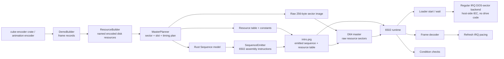

# Scripted Intro Sequence — Detailed Design

## 1. Goal & scope

Replace the intro’s current hard-coded “decode and play the whole embedded stream” path with an explicit control sequence that tells the C64 runtime:

- when to start an asynchronous disk load,
- **which disk resource** to load and which memory area to load it into,
- when to wait until loading is complete,
- which frame ranges to play and for how long,
- when to pause for refreshes,
- when to loop, including future condition-driven loops such as “until music is before …” and “until disk is turned”,
- when to end/hold.

The important simplification in this design: **the sequence is authored in Rust, and Rust emits ordinary 6502 assembly that is included in the PRG**. There is no custom bytecode, no opcode table, no interpreter, no script pointer, and no runtime loop stack. The generated assembly uses labels and branches for loops, and JSR instruction patterns for loader, resource, and frame operations.

Rust’s job is the deterministic build-time work:

- encode the animation into frame records,
- split those records into disk resources,
- compute each resource’s exact byte count,
- derive sector counts, track/sector starts, and destinations,
- reserve raw D64 sectors,
- author the sequence as a typed model,
- emit the sequence as 6502 assembly instructions,
- emit a resource table and named constants used by that assembly.

Terminology used below:

- **Sequence** — the Rust-authored control-flow model.
- **Emitted sequence assembly** — the generated 6502 instructions included in the PRG.
- **Frame resource** — a disk resource containing complete frame-command records.
- **Music resource** — a disk resource loaded into a dedicated banked-out RAM region.
- **Runtime primitive** — a JSR instruction pattern emitted by Rust into the sequence.

### In scope

- Rust resource model and deterministic master planner.
- Rust sequence model and assembly emitter.
- Generated resource table and named constants.
- Emitted assembly sequence using loader/wait/play/wait-refresh primitives.
- Async single-job loader contract; the one-load-before-next-wait discipline is validated in Rust, while `WaitLoaded` only polls IRQ completion.
- A selectable loader backend. The default “regular” backend is host-side, IRQ-driven 1541 DOS-sector reads over the standard IEC serial bus (no custom drive code) and is designed so frame playback continues while a load is in flight.
- Shared IRQ dispatcher for refresh pacing and loader servicing.
- Frame resource pool at `$4000..$9FFF`.
- Music region at `$A000..$BFFF`, requiring ROM bank-out.
- D64 raw-sector mastering.
- Tests and reports.

### Out of scope / follow-up

- Custom 1541 drive-code fastloaders (Krill/Spindle/Bitfire/DreamLoad-style). The default regular backend uses only standard DOS sector commands and host-side IEC bit-banging; a future backend can replace it without changing the emitted sequence or resource table.
- Wiring the real music driver. `MUSIC_POSITION_ADDR` remains a placeholder input for now; Phase 6 emits the condition-loop shape but does not claim a music source.
- A bytecode script interpreter. Earlier versions of this design had one; it is intentionally removed as unnecessary complexity.
- A hand-maintained intro assembly file for the sequence. Rust is the authoring layer and generates the assembly from the same plan that emits the resource table.
- Changing the frame-command format (`DemoBuilder` / `FrameBuilder` / `Command`).
- Changing block compression, charset strategy, or the 4-refresh-per-frame pacing from `.designs/refresh-rate.md`.
- Huffman/runtime decompression from `.designs/ideas.md`.

---

## 2. Current state and why an explicit sequence is needed

### 2.1 What `intro.rs` used to do

Before Phase 3, `src/builder/src/applications/intro.rs` embedded a ~11,624-byte literal stream:

```rust
let data = vec![
    0x64, 0x00, ... // 0x0064 = 100 frames
];
let engine_data = ModuleBuilder::default()
    .name("engine_data")
    .instructions(InstructionBuilder::default().label("engine_data").raw(&data).build())
    .build();

let application = ApplicationBuilder::default()
    .name("Engine")
    .include_vic2_defines()
    .module(/* main: add_basic_header; jsr engine__init; jsr engine__play; rts */)
    .add_engine()
    .module(engine_data)
    .build()
    .unwrap();
```

The main program is effectively:

```asm
jsr engine__init
jsr engine__play
rts
```

`engine__play` reads the top-level frame count, decodes every frame sequentially, waits four refreshes after each frame, and loops forever on the final frame.

Problems:

1. The whole stream is embedded in the PRG, so the intro cannot stream from disk.
2. Timing is implicit: “play all frames” is hard-coded inside the executable.
3. There is no place to express “start loading now, play current data, wait for load, then play it”.
4. The literal in `intro.rs` is a stale 100-frame/11,624-byte baseline; `.designs/streaming.md` already uses newer 200-frame measurements (12,361 B total).
5. The application is still named `"Engine"`, showing that the intro is a copy/adaptation of the engine application.

Phase 3 removed this literal. `intro.rs` now calls the `cube-encoder` crate to encode both rendered acts, plans their disk resources, and emits a Rust-authored 6502 sequence plus the generated `resource_table`.

### 2.2 Existing stream format (unchanged)

`DemoBuilder` (`src/c64-encoder/src/builder/demo.rs`) emits:

```text
u16 frame_count
repeat frame_count times:
    u16 command_count
    repeat command_count times:
        u8 opcode
        opcode-specific payload
```

`FrameBuilder::byte_size()` is already sufficient to compute frame record sizes without decoding payloads. A **frame record** is the `u16 command_count` plus its command bytes. After `engine__frame__process`, `CURRENT_PTR` points at the next frame record because every command decoder advances the pointer by exactly its encoded size.

Disk frame resources contain only frame records, not the global `frame_count` header. The emitted sequence knows how many frames to play via generated constants emitted by Rust.

### 2.3 Why loader/timing operations are not frame `Command`s

The loader/timing operations are not frame content. If they were added to `Command`:

- `evaluate()` would need to understand them or debug rendering would panic.
- `DemoBuilder` frame sizes would include timing, disturbing strategy selection.
- A frame would gain multiple entry points, exactly the complication noted in `.designs/ideas.md`.
- The same frame stream could not be replayed from different buffers with different timing.

Therefore control remains in emitted PRG assembly, authored by Rust. The existing `Command` enum, dispatcher, and evaluator are untouched.

---

## 3. Architecture



Runtime responsibilities:

| Component | Owns | Does not own |
|---|---|---|
| Rust `Sequence` model | Control flow, loops, load ordering, frame counts | Physical layout |
| `SequenceEmitter` | Generating 6502 assembly instructions and labels | Runtime interpretation |
| Frame decoder | One frame record at `CURRENT_PTR` | Which resource/chunk to play next |
| Loader backend | Async resource request, completion flag, destination fill | Timing decisions |
| Regular DOS-sector backend | Host-side IEC/U1 sector reads advanced from IRQ | Sequence control flow, music-driver specifics |
| IRQ dispatcher | Refresh countdown + loader backend servicing | Sequence control flow |
| Condition provider | Current music position, latched disk-turned signal | Choosing loop exits |
| MasterPlanner | Sector ranges, destinations, reports from encoded resource sizes | Actual drive transfer |

This refines `.designs/streaming.md`: its generic `RequestReadRange` / `WaitRead` become `engine__loader__start(resource)` / `engine__loader__wait_loaded()`, and the byte-wise ring is instantiated as six 4 KiB frame slots spanning `$4000..$9FFF`.

---

## 4. Rust-authored sequence emitted as assembly

### 4.1 Authoring model

The intro control flow is written in Rust as a typed `Sequence` made of `SequenceStep` values. `SequenceEmitter` validates the model and emits ordinary 6502 assembler instructions (`Instructions` in the current builder; optionally formatted `.asm` text for inspection/debugging). That emitted module is included in `intro.prg`.

This is **not** a runtime script. The PRG contains only the emitted instructions. There is no `SEQUENCE_PTR`, opcode dispatch loop, byte-code buffer, or runtime loop stack. Labels and branches are allocated by the emitter at build time.

The emitter enforces the single-job rule **in Rust, at build time**, before emitting any instructions. `SequenceEmitter::validate` walks every path through the AST with an `active_load: Option<ResourceId>` state:

- `Load` is legal only when `active_load == None`; it sets `active_load = Some(id)`.
- `WaitLoaded` is legal only when `active_load == Some(_)`; it clears the state.
- `PlayFrames` is legal only when its resource is not `active_load`; it does not change the state.
- `RepeatCount` / `RepeatUntil` bodies must be balanced: they start and end with `active_load == None`, so a loop cannot leak a pending load into the next iteration.
- `End` is legal only when `active_load == None`.

Invalid sequences fail the build. There is deliberately **no** `LOADER_WAIT_REQUIRED` byte in zero page and no runtime guard branch: runtime code trusts the emitted sequence. The only runtime wait is `engine__loader__wait_loaded`, which polls the IRQ-driven completion flag.

### 4.2 Runtime primitives

The first column names the Rust sequence step; the second column is the emitted instruction pattern.

| Sequence step | Emitted instruction pattern | Runtime action |
|---|---|---|
| `Init` | `jsr engine__init` / `jsr engine__loader__init` / `jsr engine__condition__init` | VIC/IRQ setup, ROM bank-out, loader and condition initialization. |
| `Load(resource)` | `lda #R_ID` / `jsr engine__loader__start` | Schedule the async IRQ load of resource `R_ID`. Rust validation has already proven no other job is pending. |
| `WaitLoaded` | `jsr engine__loader__wait_loaded` | Poll until the in-flight resource is done. No runtime latch is cleared here. |
| `PlayFrames(resource, offset, count)` | `lda #R_ID`, offset bytes, `jsr engine__resource__use`, count bytes, `jsr engine__frame__play_n` | Set `CURRENT_PTR`, then call `engine__frame__process` `count` times. |
| `WaitRefreshes(n)` | `lda #n` / `jsr engine__refresh__wait_n` | Wait `n` refresh intervals. Useful for holds/act separators. |
| `RepeatCount(n, body)` | generated label + `dex` / `bne` | Emit the body with a counted loop. Nesting is ordinary generated labels/branches. |
| `RepeatUntil(condition, body)` | generated label + condition JSR + `beq`/`jmp` | Emit a post-test condition loop. Reserved for the later condition phase. |
| `End` | `jsr engine__loader__deinit` / `jsr engine__deinit` / `rts` | Shut down cleanly. |

The emitter inlines these patterns. The instruction blocks below are the emitted shape, not a hand-written macro library or a runtime parser.

### 4.3 Rust authoring example

This matches the requested semantics: load one resource, wait, start the next load, play the current frames while the next load is in flight, then wait before using it.

```rust
let sequence = Sequence::new("intro_main")
    .init()
    .load(plan.id("music0"))
    .wait_loaded()
    .load(plan.id("act1_p0"))
    .wait_loaded()
    .load(plan.id("act1_p1"))
    .play(plan.id("act1_p0"), 0, plan.frames("act1_p0"))
    .wait_loaded()
    .play(plan.id("act1_p1"), 0, plan.frames("act1_p1"))
    .load(plan.id("act1_p2"))
    .play(plan.id("act1_p1"), 0, plan.frames("act1_p1"))
    .wait_loaded()
    .play(plan.id("act1_p2"), 0, plan.frames("act1_p2"))
    .wait_refreshes(plan.value("ACT_GAP_REFRESHES"))
    .load(plan.id("act2_p0"))
    .wait_loaded()
    .play(plan.id("act2_p0"), 0, plan.frames("act2_p0"))
    .end();

let sequence_instructions = SequenceEmitter::new(&plan).emit(&sequence)?;
```

`SequenceEmitter` turns that model into instructions equivalent to:

```asm
seq_intro_main:
    jsr engine__init             ; VIC/IRQ setup + bank out $A000..$BFFF
    jsr engine__loader__init
    jsr engine__condition__init

    ; Cold start: music from its own region.
    lda #R_MUSIC
    jsr engine__loader__start
    jsr engine__loader__wait_loaded

    ; Cold start: first frame chunk.
    lda #R_ACT1_P0
    jsr engine__loader__start
    jsr engine__loader__wait_loaded

    ; Start next chunk; only one job may be in flight.
    lda #R_ACT1_P1
    jsr engine__loader__start

    ; Play act 1 part 0 while part 1 loads asynchronously.
    lda #R_ACT1_P0
    ldx #$00
    ldy #$00
    jsr engine__resource__use
    lda #<FRAMES_ACT1_P0
    ldx #>FRAMES_ACT1_P0
    jsr engine__frame__play_n

    ; Part 1 must be complete before it becomes the play source.
    jsr engine__loader__wait_loaded
    lda #R_ACT1_P1
    ldx #$00
    ldy #$00
    jsr engine__resource__use
    lda #<FRAMES_ACT1_P1
    ldx #>FRAMES_ACT1_P1
    jsr engine__frame__play_n

    ; Next chunk can now be scheduled.
    lda #R_ACT1_P2
    jsr engine__loader__start
    lda #R_ACT1_P1
    ldx #$00
    ldy #$00
    jsr engine__resource__use
    lda #<FRAMES_ACT1_P1
    ldx #>FRAMES_ACT1_P1
    jsr engine__frame__play_n
    jsr engine__loader__wait_loaded
    lda #R_ACT1_P2
    ldx #$00
    ldy #$00
    jsr engine__resource__use
    lda #<FRAMES_ACT1_P2
    ldx #>FRAMES_ACT1_P2
    jsr engine__frame__play_n

    lda #ACT_GAP_REFRESHES
    jsr engine__refresh__wait_n

    lda #R_ACT2_P0
    jsr engine__loader__start
    jsr engine__loader__wait_loaded
    lda #R_ACT2_P0
    ldx #$00
    ldy #$00
    jsr engine__resource__use
    lda #<FRAMES_ACT2_P0
    ldx #>FRAMES_ACT2_P0
    jsr engine__frame__play_n

    jsr engine__loader__deinit
    jsr engine__deinit
    rts
```

Generated constants such as `R_MUSIC`, `R_ACT1_P0`, `FRAMES_ACT1_P0`, and `ACT_GAP_REFRESHES` come from the Rust planner. The Rust sequence source never writes track numbers, sector counts, or byte sizes by hand.

### 4.4 Counted loops

Counted loops are authored structurally in Rust and emitted as generated labels and branches:

```rust
Sequence::new("title_loop")
    .repeat_count(REPEAT_COUNT, |body| {
        body.play(plan.id("title_loop"), 0, plan.frames("title_loop"));
    })
    .end();
```

Emitted shape:

```asm
    ldx #REPEAT_COUNT
seq_repeat_0:
    txa
    pha
    lda #R_TITLE_LOOP
    ldx #$00
    ldy #$00
    jsr engine__resource__use
    lda #<FRAMES_TITLE_LOOP
    ldx #>FRAMES_TITLE_LOOP
    jsr engine__frame__play_n
    pla
    tax
    dex
    bne seq_repeat_0
```

The counter is saved on the stack because the emitted primitives clobber X. There is no loop stack; nesting is just generated assembly structure with unique labels.

### 4.5 Future condition-driven loops

“Repeat until disk is turned” and “repeat until music is before …” will also be authored in Rust and emitted as label loops plus condition JSR calls, not opcodes.

```rust
Sequence::new("wait_disk")
    .repeat_until(Condition::DiskTurned, |body| {
        body.play(plan.id("wait_loop"), 0, plan.frames("wait_loop"));
    })
    .end();
```

Emitted shape:

```asm
seq_wait_disk_0:
    jsr engine__condition__disk_turned
    beq seq_wait_disk_0_done
    lda #R_WAIT_LOOP
    ldx #$00
    ldy #$00
    jsr engine__resource__use
    lda #<FRAMES_WAIT_LOOP
    ldx #>FRAMES_WAIT_LOOP
    jsr engine__frame__play_n
    jmp seq_wait_disk_0
seq_wait_disk_0_done:
```

```rust
Sequence::new("music_wait")
    .repeat_until(Condition::MusicBefore(MUSIC_TARGET_POSITION), |body| {
        body.play(plan.id("intro_loop"), 0, plan.frames("intro_loop"));
    })
    .end();
```

Emitted shape:

```asm
seq_music_wait_0:
    lda #MUSIC_TARGET_POSITION
    jsr engine__condition__music_before
    beq seq_music_wait_0_done
    lda #R_INTRO_LOOP
    ldx #$00
    ldy #$00
    jsr engine__resource__use
    lda #<FRAMES_INTRO_LOOP
    ldx #>FRAMES_INTRO_LOOP
    jsr engine__frame__play_n
    jmp seq_music_wait_0
seq_music_wait_0_done:
```

Both are label loops with the condition sampled at the top: `Z=1` exits immediately through the generated `_done` label; otherwise the body plays once and the back-edge rechecks the condition. This keeps the condition check a plain JSR call and needs no runtime loop state.

The conditional body still obeys the single-job loader rule: it may contain `Load` / `WaitLoaded` pairs, but never two `Load`s before a wait.

---

## 5. Disk resources

### 5.1 Named resources

A resource is identified by a numeric `ResourceId` and a build-time `name`. The name is used for generated constants, DASM labels/comments, reports, and error messages. It is **not** stored in the PRG resource table. There is no `ResourceKind` tag in memory.

Frame resources are the resources produced from `DemoBuilder` frame records; they carry a `FrameRange` so the planner and report know which frames they hold. Non-frame payloads, such as music, are added as named byte blobs with no frame range. The emitter and sequence decide what to do with a resource; the loader only needs its physical range and destination.

Examples:

```text
intro_act1_part0   -> frames 1..31    -> $4000
intro_act1_part1   -> frames 32..61   -> $5000
intro_act1_part2   -> frames 62..100  -> $6000
intro_act2_part0   -> frames 1..100   -> $7000
intro_act2_part1   -> frames 101..200 -> $8000
music_track0       -> 6144 bytes      -> $A000
```

### 5.2 Resource table entry

`Load(resource)` carries only a resource id. The generated `resource_table` stores only loader metadata:

```text
resource_table[resource_id]:
    track:          u8   ; 1-based physical 1541 track
    start_sector:   u8   ; first physical sector in master order
    sector_count:   u8   ; derived from encoded size, not from the sequence
    dest_lo:        u8
    dest_hi:        u8
    payload_lo:     u8   ; low byte of exact encoded byte count
    payload_hi:     u8   ; high byte of exact encoded byte count
```

Size: 7 bytes per resource. No kind byte and no resource-name string are stored in the PRG; names appear in generated symbols/comments and reports.

The generated `LoadRange` is the same loader information in Rust form, with the name retained for diagnostics:

```rust
#[derive(Debug, Clone, Copy, PartialEq, Eq)]
pub struct DiskLocation {
    pub track: u8,
    pub sector: u8,
}

#[derive(Debug, Clone)]
pub struct LoadRange {
    pub resource_id: ResourceId,
    pub name: String,
    pub start: DiskLocation,
    pub sector_count: u8,
    pub dest: u16,
    pub payload_bytes: u16,
}
```

### 5.3 Stability rule

The Rust sequence only names resources. If compression improves and a resource becomes one sector smaller:

- the Rust sequence source does not change,
- generated constants are regenerated,
- the emitted assembly changes only where a regenerated constant value is referenced,
- the resource table changes,
- the D64 master changes.

This is what makes development practical: sector counts are unknown while authoring and become authoritative only at final encode/master time.

---

## 6. Memory map

| Address | Purpose |
|---|---|
| `$0000..$00FF` | Zero page/workspace. Existing engine keeps `$FB`, `$FC`, `$FE`; loader uses the ranges below. |
| `$0801..$3DFF` | Generated program: BASIC stub, engine, frame decoders, Rust-emitted sequence assembly, loader, resource table. Build asserts the program ends below `$3E00`. |
| `$3E00..$3EFF` | Runtime condition/status blackboard: `$3E00` `MUSIC_POSITION_ADDR`, `$3E01` `DISK_TURNED_LATCH`, `$3E02/$3E03` saved processor-port state. |
| `$3F00..$3FFF` | Spare program-area RAM / growth margin. |
| `$4000..$4FFF` | Frame resource/slot 0. |
| `$5000..$5FFF` | Frame resource/slot 1. |
| `$6000..$6FFF` | Frame resource/slot 2. |
| `$7000..$7FFF` | Frame resource/slot 3. |
| `$8000..$8FFF` | Frame resource/slot 4. |
| `$9000..$9FFF` | Frame resource/slot 5. |
| `$A000..$BFFF` | Music region (`MUSIC_BASE = $A000`, 8 KiB). RAM under BASIC ROM; CPU access requires bank-out. Never used as a frame slot. |
| `$C000..$C3E7` | Screen RAM (VIC bank 3). |
| `$C800..$CFFF` | Charset (VIC bank 3). |
| `$D000..$DBFF` | VIC/SID/color registers. |
| `$DD00` | CIA2/VIC bank selection. |
| `$E000..$FFFF` | KERNAL/ROM unless explicitly banked out. |

Zero-page allocation:

| Address | Name | Purpose |
|---|---|---|
| `$80` | `LOADER_STATUS` | bit 0 done, bit 1 busy, bit 2 error. |
| `$81` | `LOADER_CURRENT_RESOURCE` | Resource id of last request. |
| `$82/$83` | `LOADER_DST_PTR` | Current write pointer for the loader. |
| `$84/$85` | `LOADER_REMAINING` | Exact bytes left in current request. |
| `$86` | `LOADER_ERROR` | Sticky loader error code for real transfer failures. |
| `$87` | `RESOURCE_SCRATCH_ID` | Scratch for seven-byte resource-table indexing. |
| `$88/$89` | `RESOURCE_SCRATCH_OFFSET_LO/HI` | Scratch for `engine__resource__use`. |
| `$8A/$8B` | `FRAME_PLAY_COUNT` | 16-bit count for `engine__frame__play_n`. |
| `$8C/$8D` | `LOADER_STUB_SRC` | Stub backend source pointer. |
| `$8E` | `CONDITION_VALUE` | Scratch for music-position comparison. |
| `$8F` | `REFRESH_WAIT_COUNT` | Count for `engine__refresh__wait_n`. |
| `$FB` | `SCRATCH_SPACE_00` | Existing engine scratch. |
| `$FC` | `SCREEN_CHAR_PTR` | Existing screen-character pointer. |
| `$FE/$FF` | `CURRENT_PTR` | Existing frame-command pointer. |

There is no `SEQUENCE_PTR`, no interpreter loop state, and no loop stack. In particular, `$87` is ordinary scratch; no `LOADER_WAIT_REQUIRED` latch exists at runtime.

The VIC setup remains `C64_BANK_SELECTION = 0`, `VIC2_MEMORY_SETUP = 3` from `src/c64-encoder/src/command/modules/engine.rs`. In addition, `engine__init` banks out BASIC ROM for `$A000..$BFFF` before the first music load; `engine__deinit` restores the original processor-port state.

---

## 7. 6502 runtime design

### 7.1 New/changed modules

| Module | New/changed functions | Responsibility |
|---|---|---|
| `engine.rs` | `engine__init`, `engine__stream__init`, `engine__deinit`, `engine__frame__process`, `engine__frame__play_n`, `engine__play_stream` | Split setup from playback; add frame-count primitive. |
| `resource.rs` | `engine__resource__use`, `engine__resource__dest`, `engine__resource__sector_count` | Resource-table lookups; no kind or frame-count lookup. |
| `loader.rs` | `engine__loader__init`, `engine__loader__start`, `engine__loader__wait_loaded`, `engine__loader__is_done`, `engine__loader__on_irq`, `engine__loader__deinit` | Async single-job loader contract shared by all backends. |
| `loader_regular.rs` | backend implementation of the same entry points | Default regular backend: host-side IRQ DOS-sector reads over standard IEC. |
| `loader_stub.rs` | backend implementation of the same entry points | Deterministic test backend selected explicitly by CPU tests. |
| `condition.rs` | `engine__condition__init`, `engine__condition__music_before`, `engine__condition__disk_turned`, `engine__condition__mark_disk_turned` | Condition checks for future loops. |
| `bank.rs` | `engine__bank__init`, `engine__bank__restore` | Bank out/restores `$A000..$BFFF`. |
| `irq.rs` | `engine__irq__handler` | Owns `$0314`; calls refresh + loader hooks; `JMP $EA81`. |
| `refresh.rs` | `engine__refresh__on_refresh` remains; `engine__refresh__irq` becomes a hook | Keeps countdown logic testable. |

The stale `src/engine_gen.asm` is not edited.

### 7.2 `engine` refactor

Current `engine__init` does three jobs: VIC/IRQ setup, setting `CURRENT_PTR` to a monolithic stream, and initializing `engine__frames_left`. Split them:

```asm
engine__init:
    ; VIC bank/memory setup
    ; install engine__irq__handler
    ; enable raster IRQ
    ; bank out BASIC ROM for $A000..$BFFF
    rts

engine__stream__init:
    ; legacy: set CURRENT_PTR to engine_data
    ; legacy: engine__frames_left__init
    ; legacy: advance CURRENT_PTR past the global frame count
    rts

engine__frame__process:
    ; unchanged: read command count, decode commands, engine__refresh__wait

engine__frame__play_n:
    ; loop count times: jsr engine__frame__process

engine__play_stream:
    ; legacy: loop engine__frames_left times, call engine__frame__process
```

Legacy applications call the three entry points explicitly:

```asm
    jsr engine__init
    jsr engine__stream__init
    jsr engine__play_stream
```

The intro no longer calls `engine__stream__init` or `engine__play_stream`; it calls the Rust-emitted sequence after `engine__init`.

### 7.3 Loader contract

The loader is an **asynchronous, single-job state machine**. Single-job correctness is a **Rust build-time property**: `SequenceEmitter::validate` rejects any sequence that reaches another `Load` or `End` with a pending job. Runtime has no wait-required latch; it trusts the emitted sequence. The emitted sequence only schedules and polls; the actual transfer is advanced by `engine__loader__on_irq` from the IRQ handler. There is no queue and no second job descriptor.

```text
                   Load
        (Rust has proven no pending job)
                         |
                         v
                     LOADING --------------> DONE
                         ^                    |
                         |                    | WaitLoaded
                  IRQ advances job            | (poll done only)
                         |                    v
                         +--------------> IDLE/READY
                                               |
                                  next Load only in a Rust-validated path
```

| Function | Contract |
|---|---|
| `engine__loader__init` | Initialize shared state and let the selected backend initialize itself. The regular backend does not enable CIA2 Timer A here; it starts the timer only for an active job. |
| `engine__loader__start` | `A = resource_id`. Look up `resource_table[resource_id]`, copy the single job descriptor, set `LOADER_DST_PTR`, set busy/clear done, ask the selected backend to begin, and return immediately. It does not maintain or check a wait-required flag. |
| `engine__loader__on_irq` | Called from `engine__irq__handler`. If busy, advance the one active job by a bounded chunk through the selected backend. Set done when complete. |
| `engine__loader__is_done` | `Z=1` when bit 0 of `LOADER_STATUS` is set. Byte access is atomic with respect to the IRQ. |
| `engine__loader__wait_loaded` | Spin on `is_done`, then return. It does not clear a latch or re-arm `Load`. |
| `engine__loader__deinit` | Stop transfer, restore borrowed vectors/resources. |

Directly calling `engine__loader__start` outside generated code with an active job is outside the contract and would overwrite the single descriptor. All production callers come from the validated Rust AST, so this cannot be emitted by mistake.

Backend selection is a **build-time Rust choice**, not a runtime mode byte. `add_engine()` installs the regular DOS-sector backend; tests may install the stub backend through the engine builder. Both backends expose the same `engine__loader__*` entry points to the emitted sequence, so no generated sequence step changes when the backend changes.

Initial implementation strategy:

1. **Default regular backend** (`loader_regular.rs`): host-side state machine using standard 1541 DOS commands. It opens/uses a buffer, issues `U1` for each physical `(track, sector)`, reads the 256-byte sector over the standard IEC serial bus, and copies it to the resource destination. No custom 1541 drive code is uploaded and no KERNAL serial routine is called from an IRQ. Starting a job enables CIA2 Timer A; each timer IRQ advances one bounded IEC phase, while the raster IRQ stays once-per-frame, so `engine__frame__process` keeps running on the main thread while a load is in flight.
2. **Test stub** (`loader_stub.rs`): `start` copies a preloaded byte image into the destination and sets done immediately (or in bounded IRQ chunks). This keeps the whole sequence testable under `mos6502` without modelling the serial bus.
3. **Future backends**: a custom-drive-code loader can replace the regular backend behind the same entry points. Track/sector order, interleave, and D64 mastering remain planner concerns; the sequence never learns the transfer mechanism.
4. **Bootstrap remains a follow-up**: the regular backend is expected to load the first resources itself. If cold-start reliability later requires KERNAL-loading a bootstrap resource, that changes only the first emitted `Load`/`WaitLoaded` pair, not the backend contract.

### 7.4 IRQ ownership

`.designs/refresh-rate.md` currently has `engine__refresh__irq` installed directly at `$0314`. With a loader, two components need IRQ time. Introduce one owner:

```asm
engine__irq__handler:
    lda VIC2_IRQ_STATUS                   ; raster pending?
    and #$80
    beq cia
    jsr engine__refresh__on_refresh       ; once-per-frame pacing countdown
    asl VIC2_IRQ_STATUS                   ; acknowledge raster source
cia:
    lda CIA2_IRQ_CONTROL                  ; Timer A pending? read also acknowledges
    and #$01
    beq done
    jsr engine__loader__on_irq            ; advance one IEC phase of the active load
done:
    jmp $EA81
```

Actual disk transfers happen asynchronously relative to the emitted sequence. A `Load` step must never copy sector bytes itself; `engine__loader__start` only publishes the one job descriptor and starts the timer. The raster hook remains dedicated to refresh pacing; CIA2 Timer A drives the IEC state machine only while a regular-backed job is active.

`engine__refresh__irq` becomes a compatibility hook/wrapper that calls the same dispatcher shape for refresh-only tests. `engine__refresh__init` installs `engine__irq__handler` instead of installing itself directly.

Acknowledgement rule:

- Raster: `ASL VIC2_IRQ_STATUS` acknowledges the sole VIC source.
- CIA2 Timer A: reading `CIA2_IRQ_CONTROL` acknowledges the pending timer flag. The regular backend stops the timer and clears the flag on completion, error, and deinit.
- If both sources are pending, check both status registers and acknowledge both; the loader hook is only called for the CIA source so refresh stays once per frame.

### 7.5 Condition provider

Condition checks are simple JSR routines returning `Z=1` when true:

```text
engine__condition__music_before(value)   ; Z=1 if current position < value
engine__condition__disk_turned()         ; Z=1 if DISK_TURNED_LATCH != 0
```

`DISK_TURNED_LATCH` is sticky: once the backend reports the disk is turned, it stays set until `engine__condition__init` resets it. This prevents a noisy status signal from restarting the loop.

The exact production source is backend-specific:

1. **Stub/tests** — a test calls `engine__condition__mark_disk_turned` directly.
2. **Regular backend** — the first successful sector handshake after the drive starts responding sets the latch. This is a loader signal, not timing guessed by the sequence.
3. **Future backends** — a backend may set the latch from an explicit drive status byte when its protocol exposes one; otherwise the same first-success signal is used.

If “disk turned” means angular position rather than spin-up, the same latch can be replaced by a current-sector index exposed by the backend and compared with the target sector.

---

## 8. Rust encoder-side design

### 8.1 Crate placement

| Crate | New/changed responsibility |
|---|---|
| `c64-encoder` | `sequence::{model, resources, plan, emit, report}`; pure resource planning/encoding, Rust sequence authoring, assembly emission, no D64 I/O. No runtime interpreter. |
| `c64` | `create_disk::write_master_ranges(&D64, &[MasteredRange])`; raw sector writes and BAM reservation. |
| `builder` | Orchestrates encode → resource plan → Rust sequence → emitted assembly → PRG → D64; `intro.rs` becomes thin. |
| `c64-encoder-reporting` | Markdown resource/timing report rendered next to command summary. |

### 8.2 Core types

```rust
pub type ResourceId = u8;
pub type SlotId = u8;

#[derive(Debug, Clone, Copy, PartialEq, Eq)]
pub struct DiskLocation {
    pub track: u8,
    pub sector: u8,
}

#[derive(Debug, Clone, Copy, PartialEq, Eq)]
pub struct FrameRange {
    pub first: u16,
    pub last: u16,
    pub act: u32,
}

#[derive(Debug, Clone, Copy, PartialEq, Eq)]
pub struct ResourceRegion {
    pub base: u16,
    pub max_bytes: usize,
    pub requires_bank_out: bool,
}

/// Authoring/build-time description of a disk resource.
#[derive(Debug, Clone)]
pub struct DiskResource {
    pub id: ResourceId,
    pub name: String,              // debug/report/generated symbol name
    pub encoded_bytes: Vec<u8>,
    /// Some for resources built from frame records; None for music/other byte blobs.
    pub frame: Option<FrameRange>,
    /// Assigned by the planner: frame slot or fixed-region address.
    pub dest: u16,
    pub slot: Option<SlotId>,
}

/// Generated master information; sector_count is derived from encoded_bytes.
#[derive(Debug, Clone)]
pub struct LoadRange {
    pub resource_id: ResourceId,
    pub name: String,              // retained for diagnostics only
    pub start: DiskLocation,
    pub sector_count: u8,
    pub dest: u16,
    pub payload_bytes: u16,
}

#[derive(Debug, Clone)]
pub struct ResourcePlan {
    pub resources: Vec<DiskResource>,       // stable ResourceId order
    pub ranges: Vec<LoadRange>,             // generated from encoded_bytes
    pub sector_image: Vec<[u8; 256]>,       // padded payload
    pub constants: GeneratedConstants,      // R_*, DEST_*, FRAMES_*, SECTORS_*
    pub reports: Vec<ResourceReport>,
}
```

`FRAMES_*` constants come from `DiskResource.frame`; they are not fields in the runtime resource table. Bank-out is derived from `dest` falling inside `music_region` with `ResourceRegion::requires_bank_out`, not from a tag byte.

`GeneratedConstants` is emitted as assembler defines/labels so the PRG assembly uses names instead of numbers:

```asm
R_ACT1_P0       = 0
DEST_ACT1_P0    = $4000
FRAMES_ACT1_P0  = 31
SECTORS_ACT1_P0 = 16
```

The sequence authoring model is a build-time AST only:

```rust
#[derive(Debug, Clone, Copy, PartialEq, Eq)]
pub enum Condition {
    MusicBefore(u8),
    DiskTurned,
}

#[derive(Debug, Clone)]
pub enum SequenceStep {
    Init,
    Load(ResourceId),
    WaitLoaded,
    PlayFrames { resource: ResourceId, offset: u16, count: u16 },
    WaitRefreshes(u8),
    RepeatCount { count: u16, body: Vec<SequenceStep> },
    RepeatUntil { condition: Condition, body: Vec<SequenceStep> },
    End,
}

#[derive(Debug, Clone)]
pub struct Sequence {
    pub name: String,
    pub steps: Vec<SequenceStep>,
}

pub struct SequenceEmitter<'a> {
    plan: &'a ResourcePlan,
    label_counter: usize,
}

impl<'a> SequenceEmitter<'a> {
    pub fn new(plan: &'a ResourcePlan) -> Self { /* ... */ }

    /// Emits the 6502 assembler instructions included in the PRG.
    pub fn emit(&mut self, sequence: &Sequence) -> AssemblerResult<Instructions> { /* ... */ }

    /// Optional debug/diff output; equivalent to `emit()`, not executed at runtime.
    pub fn emit_asm_text(&mut self, sequence: &Sequence) -> AssemblerResult<String> { /* ... */ }

    /// Rejects unbalanced load/wait pairs and invalid play sources before emission.
    pub fn validate(sequence: &Sequence) -> AssemblerResult<()> { /* ... */ }
}
```

`SequenceStep` is an authoring type, not a runtime opcode. `SequenceEmitter::emit` produces the assembler instructions that become a `Module` in `intro.prg`. Fluent methods on `Sequence` (`init()`, `load()`, `wait_loaded()`, `play()`, `repeat_until()`, etc.) only construct this AST. `RepeatUntil` emits generated labels, a condition JSR, `beq` exit, body instructions, and a back-edge `jmp`.

### 8.3 MasterPlanner

```rust
pub struct MasterPlannerConfig {
    pub frame_region: ResourceRegion,
        // default { base: 0x4000, max_bytes: 0x6000, bank_out: false }
    pub slot_size: usize,          // default 4096
    pub slot_count: usize,         // default 6
    pub music_region: ResourceRegion,
        // default { base: 0xA000, max_bytes: 0x2000, bank_out: true }
    pub condition_status_base: u16,// default 0x3E00
    pub interleave: u8,            // default 7
    pub usable_sector_zero: bool,  // default false
    pub throughput_bps: u32,       // default 4096 (streaming.md "realistic target")
    pub refreshes_per_frame: u8,   // default 4
    pub safety_margin_frames: u8,  // default 2
}
```

Algorithm:

1. **Input**: one or more `DemoBuilder`s (act 1, act 2) plus named byte blobs such as encoded music.
2. **Frame records**: compute each `FrameBuilder::byte_size()` and keep the original bytes. Do not parse the global frame count; frame resources contain only frame records.
3. **Resource splitting**: walk frames in playback order. Close a frame resource before adding a frame that would exceed `slot_size`. Force a close at act boundaries. Assign stable `ResourceId`s in creation order and derive each `name` from act/range (for example `act1_p0`). Assert `frame_count <= u16::MAX`.
4. **Frame placement**: resources with `frame = Some(_)` get `slot = frame_resource_index % slot_count` and destination `frame_region.base + slot * slot_size`. Assert that a resource scheduled to load while another resource is still being played never uses the same slot.
5. **Auxiliary placement**: resources with `frame = None` get no frame slot. They are allocated from `music_region` using their actual `encoded_bytes.len()`. If the blob exceeds `$A000..$BFFF`, fail the build with the resource `name`, required size, and configured region. `requires_bank_out` is derived from the region and emitted into the generated startup code.
6. **Known encoded size**: `encoded_bytes` is fixed. Compute `sector_count = ceil(encoded_bytes.len() / 256)`. Pad the last sector with `0x00`. `payload_bytes` remains exact.
7. **Sector allocation**: consume logical sectors from the mastered stream order (§9). Store `start = (track, sector)` and derived `sector_count` in the generated `LoadRange`.
8. **Generated artifacts**: emit `resource_table`, named constants, the raw D64 sector image, and the timing report.
9. **Timing estimate**: for each resource, compute `needed_ms = sector_count * 256 / throughput_bps` plus optional zone-step penalty. Use the Rust sequence’s generated annotations to compute `lead_frames` from `Load` to the matching `WaitLoaded`. Classify `OK`, `TIGHT`, or `UNDERRUN_RISK`.

All allocation is deterministic: same encoded resources + same config ⇒ same tracks, sectors, and destinations. A unit test hashes the plan output to catch accidental drift. A separate test changes an encoded size but keeps resource names/order and asserts the sequence constants’ names are unchanged while values and the resource table change.

### 8.4 Integration with `intro.rs`

`intro_application()` becomes roughly:

```rust
pub fn intro_application() -> AssemblerResult<Vec<u8>> {
    Ok(build_intro()?.prg)
}

fn build_intro_from_demos(act1: &DemoBuilder, act2: &DemoBuilder) -> AssemblerResult<IntroBuild> {
    let plan = build_plan(act1, act2);
    let sequence = build_sequence(&plan);
    let sequence_instructions = SequenceEmitter::new(&plan).emit(&sequence)?;

    let mut builder = ApplicationBuilder::default();
    builder.name("Intro").include_vic2_defines();
    for (name, value) in plan.constants.iter() {
        builder.define_address(name, *value);
    }

    let application = builder
        .module(main_module_that_jsrs("intro_main"))
        .module(ModuleBuilder::default().name("intro_sequence").instructions(sequence_instructions).build())
        .module(resource_table_module(&plan))
        .module(legacy_stream_placeholder_module())
        .add_engine()
        .build()?;

    application.validate()?;
    let prg = ProgramGenerator::default().generate(application)?;
    Ok(IntroBuild { prg, plan })
}
```

`add_engine()` installs the bank, reset, IRQ, loader, resource-lookup, and condition modules together, so every application using it must provide a `resource_table` label. Legacy monolithic-stream applications use `dummy_resource_table_module()` until they are migrated; the intro uses the generated multi-entry table. The intro also provides a two-byte `engine_data` placeholder because `add_engine()` still installs the legacy `engine__stream__init` routine; the scripted sequence never calls it.

The emitted sequence module contains the ordinary 6502 control flow from §4.2. It calls JSR primitives and uses generated defines; there is no embedded frame-data literal and no bytecode script.

The 11,624-byte `data` literal is removed. The PRG contains code, assembly control flow, and a small resource table; **no frame bytes are embedded in the PRG**.

---

## 9. Disk mastering

### 9.1 Geometry

From `.designs/streaming.md`:

| Tracks | Sectors/track |
|---:|---:|
| 1–17 | 21 |
| 18–24 | 19 |
| 25–30 | 18 |
| 31–35 | 17 |

Master order rule:

- Tracks are consumed in order `1..=17`, then `19..=35`; track 18 is reserved for DOS directory/BAM.
- Physical sector 0 is skipped by default. Within a track with `N` sectors, logical index `i` maps to physical sector `1 + ((i * interleave) % (N - 1))`.
- Default `interleave = 7`. It is coprime with `20`, `18`, `17`, and `16`, so the sequence visits every usable sector exactly once in each zone.
- A resource may cross a track boundary. `LoadRange.start + sector_count` plus the same cursor rule defines the full chain.

If the chosen production loader requires a different interleave or includes sector 0, change `MasterPlannerConfig` and regenerate everything. The assembly sequence never hard-codes the mapping.

### 9.2 Example with current measurements

Current aggregate frame stream (`.designs/streaming.md`): 12,361 B / 200 frames.

With 4 KiB frame resources and no per-resource header:

- Payload sectors before resource-boundary padding: `ceil(12,361 / 256) = 49`.
- With usable sectors `1..20` on tracks 1–17, 49 sectors span tracks 1, 2, and 3.
- Frame destinations cycle `$4000`, `$5000`, `$6000`, `$7000`, `$8000`, `$9000`.

Actual resource boundaries must fall on frame boundaries, so padding can raise the final count slightly; the planner reports exact values. Act 1 (10,405 B) and Act 2 (1,956 B) are forced into separate final resources at act boundaries.

Music is mastered by the same `LoadRange` mechanism but targets `$A000..$BFFF` and is reported separately. It uses the same single-job loader and must be followed by `WaitLoaded` before another load is scheduled.

### 9.3 Writing the D64

`src/c64/src/create_disk.rs` currently only writes DOS-style linear files:

```rust
fn add_bytes(&mut self, bytes: &[u8], filename: Petscii, file_type: FileType) -> Result<()> {
    let d64_file = self.create_file(&filename, file_type, Scheme::Linear)?;
    d64_file.writer()?.write(bytes)?;
    Ok(())
}
```

Add:

```rust
pub fn write_master_ranges(disk: &mut D64, ranges: &[MasteredRange]) -> Result<()>;
```

`MasteredRange` lives in `c64::create_disk` and carries each physical `(track, sector)` alongside its 256-byte payload. `c64-encoder` maps its planner `DiskLocation` values into that type; `c64` never depends on `c64-encoder`.

Implementation notes:

1. For each `(location, sector_bytes)`, obtain `disk.blocks_ref_mut().sector_mut(location)` and copy the 256-byte payload directly.
2. Mark each location allocated in BAM (`BAMRef::allocate(location)`), so normal `add_bytes` cannot overwrite it.
3. Write PRG files after reserving the raw region, or write them first and choose raw locations from `bam().free_sectors()`. The former is deterministic and preferred.
4. Assert no mastered location is on track 18 and no location intersects a DOS file.
5. Flush the image and verify by reading back each sector.

`builder::package_dev()` then adds `intro`, `engine`, and `set black border` PRGs as before, plus the reserved raw resource region.

---

## 10. Timing and correctness model

### 10.1 Frame pacing

`.designs/refresh-rate.md` established:

- `REFRESHES_PER_FRAME = 4` (authored 50/4 = 12.5 fps).
- IRQ decrements a saturating countdown at raster line 0.
- `engine__refresh__wait` polls the countdown and reloads 4 when it reaches zero.

Consequences:

- `PlayFrames` gets pacing for free through `engine__frame__process`.
- Decode time counts against the four refreshes; slow decoding does not add extra refreshes.
- `WaitRefreshes(n)` waits `n * 4` raster refreshes when called sequentially.
- `WaitLoaded` does not advance framing; the displayed image holds until the resource is ready.

### 10.2 Load lead time

For a resource requested before playing the previous resource:

```text
lead_time_ms = frames_between_Load_and_WaitLoaded
             * refreshes_per_frame
             * 20 ms            (PAL raster)
needed_ms    = resource.sector_count * 256 / throughput_bps + zone_penalty_ms
margin_ms    = lead_time_ms - needed_ms
```

Status thresholds:

- `OK`: `margin_ms >= safety_margin_frames * frame_duration`.
- `TIGHT`: positive margin but below safety margin.
- `UNDERRUN_RISK`: negative margin; `WaitLoaded` will hold the frame.

Use PAL 20 ms raster for the conservative model. NTSC needs a separate config (`16.7 ms`), but the authored 12.5 fps pacing is unchanged.

### 10.3 Invariants

1. There is at most one active loader job because Rust validation rejects any sequence with two `Load` steps before `WaitLoaded`; no runtime wait-required latch exists.
2. The IRQ writes only to the destination of the resource named by the active `Load`; Rust validation prevents a second `Load` from overwriting that descriptor.
3. `PlayFrames` source resource is never the active load resource; this is checked by Rust validation.
4. A frame slot is not reused until its previous `WaitLoaded` has completed and its last frame has been played.
5. `CURRENT_PTR` is modified only by `engine__resource__use` and frame decoders, never by the IRQ.
6. Frame resources fit entirely in `$4000..$9FFF`; music fits entirely in `$A000..$BFFF`; the two regions never overlap.
7. BASIC ROM is banked out before the first access to `$A000..$BFFF` and restored by `engine__deinit`.
8. `LOADER_STATUS` byte reads/writes are atomic; 16-bit loader state is only touched by IRQ-disabled sections or by the IRQ owner.
9. `resource_table` and generated constants are immutable after program start.
10. Every frame resource contains complete frame records; no frame is split across sectors/resources by the planner.
11. The emitted sequence contains no track/sector/sector-count constants; those exist only in generated constants, the resource table, and the D64 master.
12. `DISK_TURNED_LATCH` is sticky until `engine__condition__init`, and condition evaluation has no side effects on the loader job.

---

## 11. Reports and diagnostics

Extend `c64-encoder-reporting` with a resource table:

```text
| resource | id | act | frames | bytes | sectors | t/s start | dest | lead frames | need ms | margin ms | status |
|---------:|---:|----:|-------:|------:|--------:|----------:|-----:|------------:|--------:|----------:|:------:|
| act1_p0  | 0  | 1   | 31     | 4096  | 16     | 1/1       | 4000 | -           | 1024   | -          | boot   |
| act1_p1  | 1  | 1   | 30     | 3900  | 16     | 1/21      | 5000 | 31         | 1024   | 1216      | OK     |
| music0   | 2  | -   | -      | 6144  | 24     | 2/1       | A000 | -           | 1536   | -          | boot   |
```

Also print:

- total sectors and tracks used, split by destination region (`$4000..$9FFF` vs `$A000..$BFFF`),
- frame-slot assignments and the `$4000..$9FFF` region layout,
- music size, `$A000..$BFFF` usage, and bank-out flag,
- interleave and geometry assumptions,
- throughput/margin assumptions,
- any `TIGHT`/`UNDERRUN_RISK` warnings,
- a deterministic plan hash.

The existing command summary and charset-redundancy report remain unchanged; resource planning is orthogonal to encoding strategy choice.

---

## 12. Validation plan

### 12.1 Rust / CI

CI already runs `cargo fmt --check`, `cargo build`, and `cargo test`:

```bash
cargo fmt --all -- --check
cargo build --workspace
cargo test --workspace
```

New tests:

1. **Resource sizing** — each generated `LoadRange.sector_count == ceil(resource.encoded_bytes.len() / 256)`; `payload_bytes == encoded_bytes.len()`; padding is deterministic.
2. **Resource table encoding** — table rows are 7 bytes, little-endian fields are correct, and the table contains no kind byte or name string.
3. **Sequence stability** — changing encoded byte sizes while keeping resource names/order leaves the Rust sequence source and generated label names unchanged; only constant values, emitted immediate values, table/D64 data change.
4. **Planner invariants** — frame resources respect frame boundaries and `slot_size`; act boundaries force a new resource; music fits `$A000..$BFFF` or fails the build; slot reuse does not collide with in-flight loads; deterministic plan hash.
5. **Rust single-job validation** — `SequenceEmitter::validate` accepts balanced sequences and rejects: two `Load`s before `WaitLoaded`, `WaitLoaded` with no pending load, `End` with a pending load, `PlayFrames` on the active load resource, and loop bodies that leak a pending load. The generated application contains no wait-required latch or runtime guard branch.
6. **Geometry** — interleave is coprime with every `N-1`; sector cursor visits each usable sector once; track 18 is never allocated; a 49-sector plan spans the expected tracks.
7. **Runtime primitives with stub loader** — generate an application with the resource table and run under `mos6502` as in `refresh_countdown.rs`. Assert:
   - `engine__resource__use` sets `CURRENT_PTR` from the resource destination,
   - `engine__frame__play_n` decodes exactly N frames,
   - `engine__loader__wait_loaded` returns only when stub status is done and performs no latch update,
   - `engine__refresh__wait_n` calls the refresh stub N times,
   - `engine__condition__disk_turned` and `engine__condition__music_before` set/clear `Z` correctly.
8. **Structural DASM assertions** — full intro application contains the emitted sequence label, `engine__loader__start`, `engine__loader__wait_loaded`, `engine__frame__play_n`, `resource_table`, `engine__irq__handler`, and `engine__bank__init`; no bytecode interpreter symbols are present.
9. **D64 mastering** — build an in-memory D64, write raw ranges including music, add a DOS PRG, then read back raw sectors and assert BAM allocation prevents overlap.
10. **Intro application validation** — `application.validate()` passes; generated PRG does not contain the legacy 11,624-byte literal; resource-table size is within expected bounds.
11. **Backend selection and overlap** — the default engine contains the regular DOS-sector backend, tests can build the same entry points with the stub backend, and a CPU-level sequence test shows frame decoding progressing between `start` and `wait_loaded` for the same job.
12. **Condition-loop emission** — `RepeatUntil(MusicBefore(_))` and `RepeatUntil(DiskTurned)` emit generated labels, condition JSR calls, `beq ..._done`, body instructions, and a back-edge `jmp`; no condition opcodes or runtime interpreter state are introduced.

### 12.2 Emulator / hardware

1. Run VICE with true drive emulation and trace `LOADER_STATUS` transitions by resource id.
2. Confirm each emitted `WaitLoaded` is satisfied before its corresponding `PlayFrames` and before the next emitted `Load`.
3. Confirm only one IRQ loader job is active at a time; because Rust validation rejects unbalanced sequences, no runtime guard is exercised.
4. Confirm frame resources load into `$4000..$9FFF` and music into `$A000..$BFFF` with ROM banked out.
5. Once condition loops are enabled, verify “until disk turned” exits after spin-up and “until music before” exits at the expected music tick.
6. Capture debug frames from scripted playback and compare against `evaluate()` output from the original `DemoBuilder` bytes.
7. Measure effective fps: expect 12.5 fps when loads are ready; expect holding (no extra refreshes) when a load is late.
8. Repeat on PAL and NTSC VIC settings.
9. On real 1541, tune interleave using the report; regenerate ranges if the value changes.

### 12.3 Acceptance criteria

- The intro PRG no longer embeds the full animation.
- The Rust-authored, emitted sequence refers to disk resources, never to sector counts or physical sector numbers.
- Rust validation proves every `Load` is paired with `WaitLoaded` before another `Load`; no `LOADER_WAIT_REQUIRED` latch or runtime guard branch exists.
- There is no bytecode script, interpreter loop, opcode table, or loop stack in the generated application.
- The encode-time report gives exact track/sector counts and destinations derived from known resource sizes, including music.
- Music loads into `$A000..$BFFF` with ROM banked out and is never decoded as frames.
- All existing decoder tests and `engine_with_block_decoders_validates` still pass.
- Scripted playback is frame-for-frame identical to direct playback when loads are ready.
- No slot overwrite or stale-frame regression under forced slow loads.

---

## 13. Implementation phases

### Phase 0 — design
✅ Completed by this document.

### Phase 1 — Rust model, planner, and sequence emitter
- [x] Add `src/c64-encoder/src/sequence/{model,resources,plan,emit,report}.rs`.
- [x] Expose frame record sizes from `DemoBuilder`/`FrameBuilder` without parsing payloads.
- [x] Implement resource splitting, six-slot frame placement, music region validation, sectorization, geometry cursor, and `LoadRange` derivation.
- [x] Implement the `Sequence` AST, `SequenceEmitter`, and build-time single-job validation with no runtime latch.
- [x] Generate resource-table bytes and named constants.
- [x] Add unit tests for sizing, stability, planner, geometry, bank-out flags, emitted assembly, and sequence validation.

### Phase 2 — 6502 runtime
- [x] Add `resource.rs` with resource-table lookups and `CURRENT_PTR` setup.
- [x] Add `loader.rs` with the Rust-validated single-job async state machine and stub backend; no wait-required flag.
- [x] Add `bank.rs` for `$A000..$BFFF` bank-out/restore.
- [x] Add `condition.rs` with music-position and disk-turned checks.
- [x] Add `irq.rs`; move refresh vector installation behind the shared dispatcher.
- [x] Refactor `engine.rs` into setup, frame primitive, and legacy playback path.
- [x] Add CPU-level and structural tests.

### Phase 3 — builder integration
- [x] Remove the embedded stream literal from `intro.rs`; the renderer/encoder moved to the `cube-encoder` crate.
- [x] Emit the assembly control sequence with the requested load/wait/play ordering.
- [x] Generate `resource_table` and constants into the intro application.
- [x] Make the intro `main` module call the emitted sequence; the sequence’s `Init`/`End` steps call engine/loader/condition setup and teardown.
- [x] Keep legacy `engine` / `senimul` applications working via `engine__stream__init` + `engine__play_stream`.

### Phase 4 — disk mastering
- [x] Add `write_master_ranges()` to `src/c64/src/create_disk.rs`.
- [x] Reserve raw sectors in BAM before writing DOS PRGs.
- [x] Update `builder::package_dev()` to master the planned resources.
- [x] Add D64 read-back/BAM tests.

### Phase 5 — regular IRQ DOS-sector loader
- [x] Make the regular host-side IEC/U1 DOS-sector backend the default selected by `add_engine()`.
- [x] Keep the deterministic stub backend available through explicit builder/test selection.
- [x] Service the regular backend from bounded steps of the shared IRQ dispatcher (CIA2 Timer A for IEC phases, raster for refresh) so frame playback continues during loading.
- [x] Add structural/CPU tests for backend selection, one-job continuity, and overlap of load and frame playback.
- [ ] Validate real drive timing and tune `interleave` in a later hardware/VICE pass.
- [ ] Add NTSC config if required.

### Phase 6 — condition loops and follow-ups
- [ ] Emit `RepeatUntil` as label loops plus condition JSR calls.
- [ ] Wire `DISK_TURNED_LATCH` to the regular loader’s first-successful-sector signal.
- [ ] Keep `MUSIC_POSITION_ADDR` as a placeholder blackboard byte until a music driver is chosen; no music driver is wired in this phase.
- [ ] Add VICE/real-drive traces for both condition exits when a real music driver and drive are available.
- [ ] Decide whether to delete `src/engine_gen.asm` or regenerate it (`mk.sh` still assembles it directly).
- [ ] Consider variable frame-slot sizes if 4 KiB slots prove inefficient.
- [ ] Add Huffman/decompression primitives from `.designs/ideas.md` without changing frame command opcodes.

---

## 14. Alternatives considered

| Alternative | Why not now |
|---|---|
| Add load/wait/loop commands to `Command` | Pollutes frame format and evaluator; breaks strategy size accounting; gives frames multiple entry points. |
| Keep hard-coded `engine__play` and only add loader commands in frame stream | Cannot express multi-resource ownership or “start load now, play other data”; timing stays implicit. |
| Put track/sector/sector counts into the Rust sequence | Development cannot know final encoded sizes; every encoding change would require rewriting the sequence. |
| Bytecode interpreter with custom opcodes | Adds script pointer, dispatch loop, loop stack, and error handling for no benefit; the sequence is small and can be ordinary emitted assembly. |
| Runtime `LOADER_WAIT_REQUIRED` latch | Duplicates a property Rust can prove at build time; costs zero-page space and runtime branches, and invalid sequences should not assemble. |
| Add a `ResourceKind` byte to the PRG table | The sequence already knows whether it plays frames or hands bytes to the music driver; the loader only needs the physical range. Names in Rust constants/reports are enough for debugging. |
| Reserve a high `0x80..` opcode namespace | Obsolete because there is no bytecode script. |
| Byte-wise 16 KiB ring from `streaming.md` | More flexible but harder to prove slot safety; six named 4 KiB frame slots are deterministic and testable. |
| One IRQ owner per component | Both need `$0314`; a single dispatcher avoids vector save/restore chains and makes ack ownership explicit. |
| Call `engine__refresh__wait` inside `WaitLoaded` | Adds four refreshes per poll and turns short waits into multi-frame stalls. |
| Music at `$8000..$8FFF` | User-reserved layout puts music at `$A000..$BFFF` and all of `$4000..$9FFF` to frame resources. |
| Generate `intro.rs` source text from the encoder | Useful later; first generate constants/resource data so the Rust sequence stays readable and Rust remains authoritative for layout. |

---

## 15. Open decisions

1. **Music driver hook** — no music driver is being wired now. `MUSIC_POSITION_ADDR` stays a placeholder byte so the condition-loop emission can be tested; a real driver and position encoding are a later decision.
2. **`DISK_TURNED` source** — resolved for this phase: the regular loader sets the latch on its first successful sector handshake. A future explicit drive-status protocol may replace that signal.
3. **Wrap-aware `BEFORE`** — half-range vs monotonic-window comparison for cyclic music positions; deferred until a real music position source exists.
4. **Loader backend** — resolved for this phase: default to the regular host-side IEC/U1 DOS-sector backend, with a build-time selector so another backend can be installed later. The sequence and resource format stay backend-neutral.
5. **Interleave** — default `7` is a safe coprime choice; final value must be measured with true drive emulation/real hardware.
6. **ROM bank-out coordination** — whether a future music driver expects ROM visible and needs it restored temporarily; no music driver is present now.
7. **Bootstrap** — the regular backend is expected to load the first resources itself. A KERNAL bootstrap remains a fallback option if cold-start testing shows a problem.
8. **Act separator** — whether to emit `WaitRefreshes(n)` between acts, and with what `n`.
9. **Legacy compatibility** — keep `engine__play_stream` permanently for tests/other apps, or remove after all applications migrate.
10. **Error policy** — sticky error + hold on loader failure vs retry. Default: sticky error, hold, report in VICE trace.
11. **NTSC** — use the same authored 12.5 fps pacing or a region-specific refresh count.

---

## 16. Summary

The intro becomes a **Rust-authored, emitted-assembly, resource-driven player**:

- Rust encodes the animation and splits it into named disk resources with known byte sizes; names are build-time diagnostics, not PRG tags.
- The PRG contains Rust-emitted 6502 assembly that starts loads, waits, plays frame ranges, pauses, loops with labels, and ends.
- There is no bytecode interpreter, no opcode table, no script pointer, no loop stack, and no `ResourceKind` byte in the resource table.
- Frame resources use six 4 KiB slots across `$4000..$9FFF`.
- Music uses `$A000..$BFFF` with ROM banked out.
- `MasterPlanner` derives each `LoadRange` from the encoded resource size and generates a 7-byte-per-resource table containing only loader metadata, plus constants and the raw D64 sector image.
- A single IRQ dispatcher owns both frame pacing and loader servicing. The default regular backend performs host-side IEC/U1 DOS-sector reads in bounded IRQ steps while frame playback continues; a stub or future custom loader can be selected at build time.
- Future “until music is before …” and “until disk is turned” loops are implemented as label loops plus condition JSR calls.

This keeps timing explicit and adjustable while preserving the frame-command format, evaluator, and compression work — without adding an unnecessary interpreter layer.
